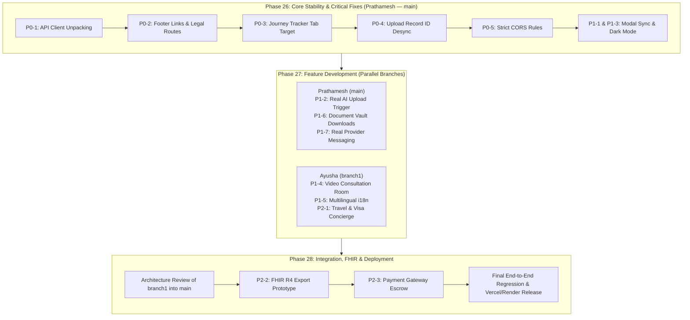

# EthAum — Phase 25: Audit Consolidation & Task Planning (Gap Analysis)

> **Document Type:** Consolidated Technical Audit & Implementation Roadmap  
> **Repository:** EthAum Healthcare Marketplace  
> **Consolidation Date:** October 2026  
> **Authors:** Prathamesh (Lead / Frontend & Architecture) & Ayusha (Backend & Specialized Features)  
> **Target Branches:** `main` (Prathamesh) and `branch1` (Ayusha)

---

## 1. Executive Summary

During Phase 24, comprehensive parallel audits of the **EthAum** codebase were completed:
* **Frontend Audit (Prathamesh):** Evaluated React 19, Vite v8, Tailwind CSS v4, React Router v7, UI components, accessibility, and state machines across 84 files. Verified production build success (`npm run build` in 1.38s) and uncovered 6 actionable client-side bugs, including broken global footer links, API response unpacking mismatches, dormant modals, and a tab desynchronization bug that rendered blank pages during the patient qualification phase.
* **Backend Audit (Ayusha):** Evaluated Node.js/Express, TypeScript, Zod schemas, Supabase integrations, Groq AI safety boundaries, and the test suite (15 passed test files, 144 passing tests). Confirmed robust RBAC, patient data isolation, and cryptographic audit trails, while identifying permissive CORS fallback rules, memory-only session fallbacks, and the absence of video calling signaling and multilingual endpoints.

This document consolidates both audits into one unified, de-duplicated engineering gap analysis. It separates **verified working features** (which must not be rewritten) from **confirmed bugs** and **incomplete features**, prioritizing them from **P0** (Critical) to **P2** (Enhancement) with assigned team ownership, target branches, and unambiguous acceptance criteria.

---

## 2. Confirmed Completed Functionality (Do Not Rebuild)

The following components and services have been inspected, tested, and verified as functioning correctly:

| Module / System | Verification Status | Evidence / Files |
| :--- | :---: | :--- |
| **Vite & Tailwind Production Build** | ✅ Verified | `dist/index.html` (1.04 kB), CSS (90.58 kB), JS (905.77 kB) generated in 1.38s. |
| **Backend Test Suite** | ✅ Verified (144/144) | All 15 test suites in `backend/tests/` passing cleanly in 13.11s. |
| **Public Marketplace Exploration** | ✅ Verified | `HomePage.jsx`, `TreatmentsPage.jsx`, `TreatmentDetailPage.jsx`, `ProvidersPage.jsx`, `ProviderDetailPage.jsx`, `DestinationsPage.jsx`, `DestinationDetailPage.jsx`, `HowItWorksPage.jsx`. |
| **Catalog Search & Filtering** | ✅ Verified | Dynamic search by keyword, procedure category, destination corridor, and maximum price slider (`TreatmentsPage.jsx`). |
| **Authentication & RBAC** | ✅ Verified | Dual-mode Supabase/JWT auth in `AuthContext.jsx` with strict route guarding in `ProtectedRoute.jsx` for `patient`, `provider`, and `admin` roles. |
| **Sovereign Case Creation & Drafts** | ✅ Verified | 4-step intake wizard in `CreateCasePage.jsx` with automatic local draft persistence in `localStorage` (`ethaum_case_draft_v1`). |
| **Patient Record Access Permissions** | ✅ Verified | Granular per-provider grant/revoke toggles in `CaseDetailPage.jsx` and `CaseRecordsPage.jsx` backed by `record_permissions`. |
| **Immutable Access Audit Logging** | ✅ Verified | Access event creation on record view/download in `medicalRecordService.ts` and `medicalRecordController.ts`. |
| **Groq AI Clinical Safety Guardrails** | ✅ Verified | Non-diagnostic system prompts, missing diagnostic detection, and automated stripping of promotional superlatives in `groqService.ts`. |
| **Objective Quote Comparison** | ✅ Verified | Side-by-side comparative matrix in `QuoteComparisonModal.jsx` without automated favoritism, featuring differential highlighting. |
| **Provider Quoting & Lead Desk** | ✅ Verified | Case lead triage, itemized quotation authoring, and inquiry answering in `ProviderPortalPage.jsx`. |
| **Consultation & Booking Scheduling** | ✅ Verified | Doctor slot selection in `ConsultationBookingModal.jsx` and admission scheduling in `TreatmentBookingModal.jsx`. |

---

## 3. Critical Bugs & Confirmed Evidence

### 🔴 Bug 1: Dead Links in Global Footer
* **Severity:** P0 (User-Facing Navigation Breakdown)
* **Owner:** Prathamesh (`main`)
* **Evidence:** In [`frontend/src/components/layout/Footer.jsx`](file:///C:/Users/jadha/OneDrive/Desktop/EthAum/frontend/src/components/layout/Footer.jsx#L6-L10):
  ```javascript
  export function Footer({ onNavigate }) {
    const handleLinkClick = (href, e) => {
      e.preventDefault()
      if (onNavigate) onNavigate(href)
    }
  ```
  In [`frontend/src/App.jsx`](file:///C:/Users/jadha/OneDrive/Desktop/EthAum/frontend/src/App.jsx#L185), `<Footer />` is instantiated without passing the `onNavigate` prop.
* **Impact:** Every single link in the footer (Treatments, Destinations, Providers, Medical Case, How It Works, Get a Quote, Patient Guide, Support, Partner Portal, Accreditation, About, Privacy, Terms) intercepts clicks with `e.preventDefault()` and does nothing. In addition, `/privacy` and `/terms` lack route definitions in `App.jsx`.

### 🔴 Bug 2: API Client Unpacking Discrepancy Breaking AI Summaries & Aftercare
* **Severity:** P0 (Data Flow Breakdown)
* **Owner:** Prathamesh (`main`)
* **Evidence:** In [`frontend/src/services/apiClient.js`](file:///C:/Users/jadha/OneDrive/Desktop/EthAum/frontend/src/services/apiClient.js#L40-L51), the Axios response interceptor unwraps `{ success: true, data: ... }` and returns `response.data.data` directly as `res`.
  However, in [`caseService.js`](file:///C:/Users/jadha/OneDrive/Desktop/EthAum/frontend/src/services/caseService.js#L596-L625) and [`aftercareService.js`](file:///C:/Users/jadha/OneDrive/Desktop/EthAum/frontend/src/services/aftercareService.js#L302-L305):
  ```javascript
  const res = await apiClient.post(`/cases/${caseId}/summary/generate`)
  if (res?.data) { ... } // res is ALREADY the data payload! res.data is undefined!
  ```
* **Impact:** `generateCaseSummary()`, `getCaseSummary()`, and `getAftercarePlan()` evaluate `if (res?.data)` to `undefined`, silently discarding valid HTTP 200 API responses from the backend and falling back to cached local storage.

### 🔴 Bug 3: Blank Screen on Journey Tracker Qualification Step
* **Severity:** P0 (Core Journey Blocker)
* **Owner:** Prathamesh (`main`)
* **Evidence:** In [`frontend/src/components/journey/JourneyTracker.jsx`](file:///C:/Users/jadha/OneDrive/Desktop/EthAum/frontend/src/components/journey/JourneyTracker.jsx#L99):
  ```javascript
  case 2: // QUALIFICATION
    return {
      title: 'Clinical Qualification & Gap Detection',
      actionLabel: 'Review Summary Facts',
      tab: 'summary', // <-- Target tab 'summary'
    }
  ```
  In [`CaseDetailPage.jsx`](file:///C:/Users/jadha/OneDrive/Desktop/EthAum/frontend/src/pages/patient/CaseDetailPage.jsx#L707-L728), the declared tabs are: `'overview'`, `'matching'`, `'records'`, `'quotes'`, `'consultation'`, `'booking'`, `'aftercare'`, `'audit'`.
* **Impact:** Clicking "Review Summary Facts" on Stage 2 sets `activeTab` to `'summary'`, which matches none of the tab render conditions in `CaseDetailPage.jsx`. The content area below the tabs renders completely blank.

### 🔴 Bug 4: Diagnostic Record Upload ID Desynchronization
* **Severity:** P0 (Data Integrity / Download Failure)
* **Owner:** Prathamesh (`main`)
* **Evidence:** In [`frontend/src/pages/patient/CaseRecordsPage.jsx`](file:///C:/Users/jadha/OneDrive/Desktop/EthAum/frontend/src/pages/patient/CaseRecordsPage.jsx#L198-L219), when a patient uploads a record:
  1. `recordService.requestUploadUrl` registers the file in the backend database with a UUID (`rec-c3fa...`).
  2. Line 214 calls `caseService.addRecord`, which assigns a local timestamp ID (`rec-${Date.now()}`) to `medicalCase.records`.
* **Impact:** When the patient subsequently clicks "Download Record" or "View Access Log", `recordService.getDownloadUrl(record.id)` requests the timestamp ID instead of the UUID, resulting in HTTP 404.

### 🔴 Bug 5: Permissive CORS Fallback in Production Backend
* **Severity:** P0 (Security Vulnerability)
* **Owner:** Prathamesh (`main`)
* **Evidence:** In [`backend/src/app.ts`](file:///C:/Users/jadha/OneDrive/Desktop/EthAum/backend/src/app.ts#L17-L29):
  ```typescript
  cors({
    origin: (origin, callback) => {
      if (!origin || /^https?:\/\/(localhost|127\.0\.0\.1|...)/.test(origin) || origin === env.FRONTEND_URL) {
        callback(null, true)
      } else {
        callback(null, true) // <-- Permissive fallback allows ALL origins!
      }
    },
    credentials: true,
  })
  ```
* **Impact:** In production, any malicious origin can execute authenticated cross-site requests against sensitive patient medical records.

### 🟡 Bug 6: Stale Initial Procedure in `CreateCaseModal.jsx`
* **Severity:** P1 (Form UX Defect)
* **Owner:** Prathamesh (`main`)
* **Evidence:** In [`frontend/src/components/common/CreateCaseModal.jsx`](file:///C:/Users/jadha/OneDrive/Desktop/EthAum/frontend/src/components/common/CreateCaseModal.jsx#L13-L15), `const [treatment, setTreatment] = useState(initialTreatment || '')` is initialized only on mount.
* **Impact:** When a user navigates between different procedure pages and clicks "Start Medical Case", the modal does not update to the clicked procedure.

### 🟡 Bug 7: Hardcoded White Backgrounds Breaking Dark Mode
* **Severity:** P1 (Theme & Visual Regression)
* **Owner:** Prathamesh (`main`)
* **Evidence:** [`AdminDashboardPage.jsx`](file:///C:/Users/jadha/OneDrive/Desktop/EthAum/frontend/src/pages/admin/AdminDashboardPage.jsx#L81-L93) and lines 111, 169, 184 use hardcoded `bg-white` classes.
* **Impact:** Toggling dark mode renders blinding white rectangular boxes with low-contrast text.

---

## 4. Incomplete Features & Missing Integrations

### Incomplete Features
1. **Aftercare Document Vault Real Downloads:**
   [`AftercareModule.jsx#L529`](file:///C:/Users/jadha/OneDrive/Desktop/EthAum/frontend/src/components/aftercare/AftercareModule.jsx#L529) only triggers a Toast. It must resolve signed URLs from `recordService` or generate download blobs for discharge summaries and implant cards.
2. **Admin Partner Verification Action:**
   [`AdminDashboardPage.jsx#L154`](file:///C:/Users/jadha/OneDrive/Desktop/EthAum/frontend/src/pages/admin/AdminDashboardPage.jsx#L154) has an "Approve Partner" button that only triggers a local Toast without updating database state.
3. **Provider Portal Messaging:**
   [`ProviderPortalPage.jsx#L400`](file:///C:/Users/jadha/OneDrive/Desktop/EthAum/frontend/src/pages/provider/ProviderPortalPage.jsx#L400) mocks messages in component state instead of calling `messageService.sendMessage()`.
4. **Dormant `LoginModal`:**
   Mounted in `App.jsx`, but never opened because login navigation directs straight to `/login`.

### Missing Feature Domains (Assigned to Ayusha)
1. **Multilingual Architecture (i18n):**
   * *Current state:* 100% hardcoded English. No translation framework exists.
   * *Target:* Implement `react-i18next` with language switcher in Navbar supporting English (`en`), Arabic (`ar`), Spanish (`es`), and Thai (`th`), with RTL support for Arabic.
2. **Video Consultation Integration:**
   * *Current state:* Appointments save static placeholder URLs (`https://meet.ethaum.health/...`).
   * *Target:* Implement a WebRTC or Daily.co pre-surgical video room component with camera/microphone toggle and in-browser clinical session controls.
3. **Travel Assistance & Concierge:**
   * *Current state:* Static text in `destinationsData.js`.
   * *Target:* Coordinated medical e-visa assistance intake, flight itinerary logging, and airport chauffeur dispatch tracker.
4. **EHR / FHIR Feasibility & Prototype:**
   * *Current state:* Custom JSON schema.
   * *Target:* FHIR Release 4 JSON exporter for `Patient`, `Condition`, `DiagnosticReport`, and `CarePlan` resources.

---

## 5. Security & Privacy Findings

1. **Patient Data Isolation:** Verified and enforced by automated tests (`securityAudit.test.ts`). Cross-patient access to `/cases/:id` and `/medical-records/:id` returns HTTP 403 Forbidden.
2. **Provider Permission Enclosure:** Providers cannot view diagnostic records without explicit patient consent via `record_permissions`.
3. **Client-Side Secrets Scan:** Verified clean. Neither `GROQ_API_KEY` nor `SUPABASE_SERVICE_ROLE_KEY` are exposed in frontend bundle or `.env`.
4. **CORS Remediation Required:** The permissive `callback(null, true)` fallback in `backend/src/app.ts` must be replaced with strict origin rejection in production.

---

## 6. Prioritized Task Table

| Task ID | Priority | Description | Affected Modules | Owner | Branch |
| :--- | :---: | :--- | :--- | :---: | :---: |
| **P0-1** | **P0** | Fix API client response unpacking mismatch for summaries & aftercare | `caseService.js`, `aftercareService.js` | Prathamesh | `main` |
| **P0-2** | **P0** | Fix dead links in global footer & add `/privacy` and `/terms` routes | `Footer.jsx`, `App.jsx` | Prathamesh | `main` |
| **P0-3** | **P0** | Fix Journey Tracker Stage 2 tab target from `'summary'` to `'overview'` | `JourneyTracker.jsx` | Prathamesh | `main` |
| **P0-4** | **P0** | Fix upload record ID desync between backend UUID and local state | `CaseRecordsPage.jsx` | Prathamesh | `main` |
| **P0-5** | **P0** | Tighten CORS origin validation to reject untrusted domains in production | `backend/src/app.ts` | Prathamesh | `main` |
| **P1-1** | **P1** | Add `useEffect` sync for `initialTreatment` in case creation modal | `CreateCaseModal.jsx` | Prathamesh | `main` |
| **P1-2** | **P1** | Connect backend Groq document intelligence on upload completion | `CaseRecordsPage.jsx`, `recordService.js` | Prathamesh | `main` |
| **P1-3** | **P1** | Fix dark mode styling regressions (`bg-white` classes) | `AdminDashboardPage.jsx`, `Dropdown.jsx` | Prathamesh | `main` |
| **P1-4** | **P1** | Build Video Consultation room component & Daily.co/WebRTC integration | `frontend/src/components/telemedicine/`, `appointmentRoutes.ts` | Ayusha | `branch1` |
| **P1-5** | **P1** | Implement `react-i18next` multilingual framework (EN, AR, ES, TH) | `frontend/src/i18n/`, `Navbar.jsx` | Ayusha | `branch1` |
| **P1-6** | **P1** | Wire Aftercare Document Vault to signed download URLs | `AftercareModule.jsx`, `aftercareService.js` | Prathamesh | `main` |
| **P1-7** | **P1** | Connect Provider Portal patient messaging to real `messageService` | `ProviderPortalPage.jsx` | Prathamesh | `main` |
| **P2-1** | **P2** | Develop Medical Travel & Visa Concierge assistance module | `frontend/src/components/travel/`, `destinationsData.js` | Ayusha | `branch1` |
| **P2-2** | **P2** | Build HL7/FHIR R4 JSON export prototype for case records | `backend/src/services/fhirService.ts` | Ayusha | `branch1` |
| **P2-3** | **P2** | Coordinate international escrow payment gateway integration | `backend/src/services/paymentService.ts` | Prathamesh | `main` |
| **P2-4** | **P2** | Clean up dormant `LoginModal` and resolve unused oxlint variables | `App.jsx`, `CaseDetailPage.jsx` | Prathamesh | `main` |

---

## 7. Task Dependencies & Acceptance Criteria

### P0-1: Fix API Client Response Unpacking
* **Dependencies:** None.
* **Acceptance Criteria:**
  1. `caseService.generateCaseSummary(caseId)` correctly receives `{ summary, corrections }` from `/cases/:id/summary/generate` without evaluating to `undefined`.
  2. `aftercareService.getAftercarePlan(caseId)` receives the live plan object from `/aftercare/:id` without falling back to local defaults when backend is running.
  3. Uses defensive extraction: `const data = res?.data !== undefined ? res.data : res`.

### P0-2: Fix Dead Footer Links & Add Legal Routes
* **Dependencies:** None.
* **Acceptance Criteria:**
  1. All links in `Footer.jsx` navigate to their respective routes via React Router `<Link to="...">` or an active `navigate` handler.
  2. Navigating to `/privacy` and `/terms` displays structured legal/compliance statements rather than redirecting to the homepage fallback.
  3. No link in the footer causes a no-op or unhandled click.

### P0-3: Fix Journey Tracker Tab Target Mismatch
* **Dependencies:** None.
* **Acceptance Criteria:**
  1. In `JourneyTracker.jsx`, Stage 2 (`QUALIFICATION`) targets `tab: 'overview'`.
  2. Clicking "Review Summary Facts" on a case in the qualification stage smoothly shifts to the overview tab and scrolls to the AI Coordination Briefing section.
  3. The page never displays an empty blank screen below the tabs.

### P0-4: Fix Diagnostic Record Upload ID Desynchronization
* **Dependencies:** None.
* **Acceptance Criteria:**
  1. In `CaseRecordsPage.jsx`, the return value of `recordService.requestUploadUrl` (which contains `uploadInit.record.id`) is passed into `caseService.addRecord`.
  2. Clicking "Download Record" or "View Access Log" immediately after uploading resolves with the correct database record UUID.
  3. Backend returns HTTP 200 for download signed URL generation.

### P0-5: Tighten CORS Origin Validation
* **Dependencies:** None.
* **Acceptance Criteria:**
  1. In `backend/src/app.ts`, origins not matching the localhost/private-IP regex or `env.FRONTEND_URL` in production return `callback(new Error('Not allowed by CORS'))`.
  2. Vitest security audit tests continue to pass (144/144).

### P1-1: Sync Initial Treatment in Case Creation Modal
* **Dependencies:** None.
* **Acceptance Criteria:**
  1. Clicking "Start Medical Case" from `/treatments/cardiac-bypass` opens `CreateCaseModal` with "Cardiac Bypass Surgery" pre-selected in the dropdown.
  2. Updating the target procedure synchronizes immediately with component state.

### P1-4: Video Consultation Room Component (Ayusha / `branch1`)
* **Dependencies:** P0-1.
* **Acceptance Criteria:**
  1. A dedicated telemedicine view (`/cases/:id/consultation/room`) is introduced.
  2. Renders video streams or an embedded Daily.co / WebRTC frame with camera, mute, and end-call controls.
  3. Clicking "Launch Video Room" in `JourneyTracker.jsx` navigates to the active room.

### P1-5: Multilingual Framework Implementation (Ayusha / `branch1`)
* **Dependencies:** None.
* **Acceptance Criteria:**
  1. `i18next` and `react-i18next` configured with language resource files for `en`, `ar`, `es`, and `th`.
  2. Navbar contains an interactive language selector dropdown.
  3. Switching to Arabic applies `dir="rtl"` to the document body and mirrors layout direction.

---

## 8. Recommended Implementation Order (Safe Execution Plan)

To prevent merge conflicts and preserve test coverage, work should proceed in three distinct phases:



1. **Step 1 (Prathamesh / `main`):** Implement P0-1 through P0-5 and P1-1. Run `npm test` and `npm run build` to confirm zero regressions on core flows.
2. **Step 2 (Ayusha / `branch1`):** In parallel, develop Multilingual framework (P1-5) and Video Consultation Room (P1-4) on `branch1`.
3. **Step 3 (Joint Review):** Merge `branch1` into `main` after mutual architectural review of i18n translation keys and consultation route structure.
4. **Step 4 (Final Polish & Release):** Implement P1-6, P1-7, and P2 items followed by comprehensive end-to-end verification.
