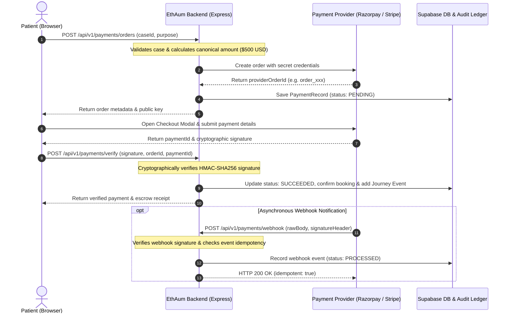

# EthAum Payment Gateway Integration Guide (Phase 30)

> **EthAum — Global Care. Closer to You.**  
> Sovereign International Healthcare Marketplace & Payment Escrow Architecture.

---

## 1. Overview & Architecture

EthAum incorporates a multi-provider payment gateway architecture designed specifically for international medical travel. The platform strictly enforces **server-authoritative pricing**, **cryptographic HMAC signature verification**, and **idempotent webhook processing**.

### Payment Model Principles:
1. **Explicit Business Logic Scope:** The platform only accepts payment for intentionally configured healthcare steps:
   - **Pre-Surgical Video Consultation Fee:** $150 USD (or local currency equivalent).
   - **Hospital Inpatient Admission Deposit:** $500 USD (held in sovereign escrow until clinical admission).
   - Full package balances remain due directly at the hospital upon check-in.
2. **Server Price Authority:** The client cannot supply payment amounts or currencies. The backend strictly determines the canonical charge based on the case, booking, and consultation records to prevent client-side price tampering.
3. **Escrow Guarantee:** Deposits are recorded as authorized escrow holds. Funds are protected and released only upon validated hospital admission.



---

## 2. Gateway Evaluation & Supported Providers

| Provider | Target Regions | Primary Use Case | Verification Algorithm |
| :--- | :--- | :--- | :--- |
| **Razorpay** | India, Southeast Asia, Middle East | Medical Visa, Indian hospital deposits, UPI, Netbanking, International Cards | HMAC-SHA256: `hash(order_id + '\|' + payment_id, key_secret)` |
| **Stripe** | US, UK, EU, Global | Global credit/debit cards, Apple Pay, Google Pay, SEPA | HMAC-SHA256: `hash(timestamp + '.' + rawBody, webhook_secret)` |
| **Sovereign Mock** | Local Development, CI/CD | Sandbox test execution with zero external network reliance | Deterministic test cryptographic signatures |

---

## 3. Environment Configuration

### Backend (`backend/.env`):
```env
# Active Provider: 'razorpay' | 'stripe' | 'mock'
PAYMENT_PROVIDER=mock

# Razorpay (Secrets - NEVER expose to frontend)
RAZORPAY_KEY_ID=rzp_test_your_key_id
RAZORPAY_KEY_SECRET=your_razorpay_key_secret
RAZORPAY_WEBHOOK_SECRET=your_razorpay_webhook_secret

# Stripe (Secrets - NEVER expose to frontend)
STRIPE_PUBLISHABLE_KEY=pk_test_your_publishable_key
STRIPE_SECRET_KEY=sk_test_your_secret_key
STRIPE_WEBHOOK_SECRET=whsec_your_webhook_secret
```

### Frontend (`frontend/.env`):
```env
# Client-side configuration (Public keys ONLY)
VITE_PAYMENT_PROVIDER=mock
VITE_RAZORPAY_KEY_ID=rzp_test_your_public_key_id
VITE_STRIPE_PUBLISHABLE_KEY=pk_test_your_publishable_key
```

> [!CAUTION]
> **Secret Key Isolation:** Never place `RAZORPAY_KEY_SECRET` or `STRIPE_SECRET_KEY` in `frontend/.env` or any client-side file. All payment order generation, verification, and webhook processing occur strictly on the backend.

---

## 4. Webhook Setup & Idempotency Protection

### Endpoint:
- **URL:** `https://api.ethaum.health/api/v1/payments/webhook` (or `/api/v1/payments/webhook/:provider`)
- **HTTP Method:** `POST`
- **Supported Events:**
  - `payment.captured`, `order.paid` (Razorpay)
  - `checkout.session.completed`, `payment_intent.succeeded` (Stripe)
  - `payment.failed`, `payment_intent.payment_failed`
  - `refund.processed`, `charge.refunded`

### Webhook Idempotency:
Every received webhook event is checked against the `payment_webhook_events` table using its unique provider event ID (`evt_xxxx`). If an event has already been processed, the backend immediately responds with:
```json
{
  "success": true,
  "data": {
    "processed": true,
    "idempotent": true,
    "eventId": "evt_xxxx"
  },
  "message": "Webhook event processed idempotently"
}
```
This guarantees that network re-deliveries from payment gateways will never cause duplicate state transitions, double-bookings, or repeated journey notifications.

---

## 5. Test Credentials & Simulation Mode

### Razorpay Test Mode:
- **Test Cards:** `4111 1111 1111 1111` (Any future expiry, CVV `123`, OTP `123456`)
- **UPI Test VPA:** `success@razorpay`

### Stripe Test Mode:
- **Test Cards:** `4242 4242 4242 4242` (Any future expiry, CVV `123`, ZIP `90210`)

### Sovereign Simulation Sandbox:
When `PAYMENT_PROVIDER=mock` or credentials are left unconfigured, EthAum operates in **Sovereign Simulation Mode**:
- Generates realistic test orders and completes full end-to-end backend cryptographic verification.
- Ideal for offline demonstrations, hackathon presentations, and automated CI/CD test suites.

---

## 6. Production Go-Live Checklist

- [ ] Complete Razorpay / Stripe merchant KYC and business registration.
- [ ] Configure Healthcare Merchant Category Code (MCC 8062 / Hospitals or MCC 8099 / Medical Services).
- [ ] Set up production Webhook endpoint with HTTPS and configure the Webhook Secret.
- [ ] Set `PAYMENT_PROVIDER=razorpay` or `PAYMENT_PROVIDER=stripe` in backend production environment.
- [ ] Run Supabase database migration `20261020000000_create_payments_schema.sql`.
- [ ] Verify Row Level Security (RLS) policies on `public.payments` and `public.payment_webhook_events`.
- [ ] Confirm no secrets are bundled in the Vite client production build.
