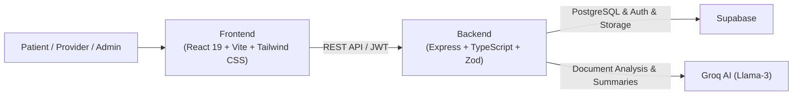

# EthAum — Project Progress & Implementation Status

> **EthAum — Global Care. Closer to You.**  
> AI-Powered International Healthcare Marketplace & Sovereign Medical Case Platform.

---

## 📊 Executive Summary & Status Dashboard

| Metric | Status | Details |
| :--- | :---: | :--- |
| **Backend Test Suite** | 🟢 **201 / 201 Passing** | 18 test suites covering auth, security, BOLA/IDOR defense, CORS, AI, journeys, quotes, bookings, travel, payments |
| **Frontend Production Build** | 🟢 **Passing** | Vite v8.3.2 client build passing (2,040 modules transformed in 722ms) |
| **Phase 24 Parallel Audits** | 🟢 **Completed** | Full-stack audit completed by Prathamesh (frontend) and Ayusha (backend) |
| **Phase 25 Gap Analysis** | 🟢 **Completed** | Consolidated in `docs/gap-analysis.md` with P0–P2 prioritized tasks & owners |
| **Phase 26 Core Stability** | 🟢 **Completed** | All 5 P0 and 2 P1 bugs fixed on `feature/phase-26-stability` |
| **Phase 27 Multilingual i18n** | 🟢 **Completed** | 5-language localization (EN, AR with RTL, FR, ES, RU) with `i18next` and bidirectional layout engine |
| **Phase 28 Video Telemedicine** | 🟢 **Completed** | In-browser Daily.co REST and WebRTC E2EE video consultation with participant authorization |
| **Phase 29 Travel & Visa** | 🟢 **Completed** | Full module on `feature/travel-assistance` with official visa resources & checklists |
| **Phase 30 Payment Gateway**| 🟢 **Completed** | Sovereign multi-provider gateway (Razorpay/Stripe/Mock) with HMAC & idempotent webhooks |
| **Phase 31 EHR/FHIR Prototype** | 🟢 **Completed** | HL7 FHIR R4 (v4.0.1) export, staging, duplicate detection & 17 passing tests |
| **Phase 32 Security & Privacy**| 🟢 **Completed** | Full-stack audit, BOLA/IDOR remediations, 23 security tests, zero secret exposure, `docs/security-audit-report.md` |
| **AI Clinical Boundary** | 🟢 **Compliant** | Groq Llama-3 coordination layer active with strict non-diagnostic guardrails |
| **Patient Data Sovereignty**| 🟢 **Active** | Explicit permission grants/revocations with immutable access audit trails |

---

## 🏗️ Architecture & Technology Stack



- **Frontend:** React 19, Vite, Tailwind CSS, React Router v7, Axios, Lucide React
- **Backend:** Node.js, Express, TypeScript, Zod Schema Validation, Helmet, Rate Limiter
- **Database & Auth:** Supabase PostgreSQL, Supabase Storage (medical records bucket), Supabase Auth
- **AI Engine:** Groq SDK (`llama-3.3-70b-versatile` / `llama-3.1-8b-instant`) with medical safety filters

---

## 📋 Phase-by-Phase Implementation Status

### Phase 0: Project Setup & Foundation
- [x] Monorepo workspace structure (`/frontend`, `/backend`, `/docs`)
- [x] Environment configuration templates (`.env.example` in frontend and backend)
- [x] Git version control with clean commit milestones
- [x] Strict TypeScript configuration and ESLint/Oxlint integration

### Phase 1: Design System & UI Components
- [x] Modern, accessible dark/light healthcare design tokens
- [x] Standard UI elements: `Button`, `Input`, `Select`, `Card`, `Badge`, `Modal`, `Drawer`, `Tabs`
- [x] Healthcare domain UI: `FileUploader`, `Timeline`, `ProgressIndicator`, `StatusBadge`, `JourneyTracker`
- [x] Toast notification and contextual feedback system (`ToastContext`)
- [x] Skeleton loaders, empty states, and resilient error boundary fallback states

### Phase 2: Public Exploration & Discovery
- [x] **Homepage:** Interactive hero, treatment quick-search, trust credentials, how-it-works, patient testimonials
- [x] **Treatments Directory & Detail:** Rich procedure profiles (e.g. Knee Replacement, Cardiac Bypass, Dental Implants), estimated costs, recovery duration, and prerequisite tests
- [x] **Providers Directory & Profile:** Hospital credentials (JCI, NABH, ISO), doctor profiles, specialty accreditations, and destination information
- [x] **Destinations Directory & Guide:** Healthcare hub overviews (India, Thailand, Turkey, Mexico, UAE) with visa and travel guidelines
- [x] **Educational Resources:** How-it-works explanation and patient FAQ

### Phase 3: Authentication & Role-Based Access Control
- [x] Dual-mode authentication: Supabase Auth + JWT-compatible backend middleware
- [x] Role separation: `patient`, `provider`, `admin`
- [x] Protected routes in frontend with automatic redirect on expiration
- [x] Patient profile linking and role verification on protected API endpoints

### Phase 4: Sovereign Medical Case Engine
- [x] Medical Case lifecycle (`draft` → `submitted` → `reviewing` → `quotes_ready` → `booked` → `in_treatment` → `aftercare` → `completed`)
- [x] Multi-step case creation wizard with treatment selection, destination preferences, budget, and clinical history
- [x] Patient case dashboard with active status tracking and coordination actions
- [x] Case detail inspection with timeline overview

### Phase 5: Patient-Controlled Medical Records
- [x] Multi-file document uploader with MIME type and size validation
- [x] Structured categorization: MRI, X-Ray, CT Scan, Blood Report, Prescription, Discharge Summary
- [x] Supabase Storage integration with secure signed download URLs
- [x] **Data Sovereignty:** Granular permission toggle per provider (Grant / Revoke access)
- [x] **Audit Trail:** Immutable record access logging (`who`, `when`, `action`, `resource`)

### Phase 6: AI Clinical Coordination (Groq AI)
- [x] **Document Intelligence:** Automatic classification, key findings extraction, and diagnostic terminology recognition
- [x] **Case Summarization:** Synthesis of disparate medical files into structured clinical coordination summaries
- [x] **Missing Information Detection:** Identifies missing vital pre-op diagnostics (e.g., recent blood work, imaging angles)
- [x] **Transparent Provider Matching:** AI explanation matching patient criteria to accredited centers
- [x] **Non-Diagnostic Guardrails:** Strict prompt boundaries prohibiting diagnosis, prescriptions, or guarantees; automated stripping of promotional superlatives

### Phase 7: Healthcare Provider Portal
- [x] Provider dashboard with lead inbox and incoming patient cases
- [x] Permitted records viewer with explicit patient consent validation
- [x] Integrated doctor assignment and consultation schedule management
- [x] Secure provider-to-patient messaging channel

### Phase 8: Quote System & Cost Transparency
- [x] Detailed itemized quote builder (hospital stay, surgeon fees, implants, anesthesia, transfers)
- [x] Explicit definition of inclusions (medication, airport pickup) and exclusions (complication insurance, extra nights)
- [x] Multi-provider quote comparison modal for patients
- [x] Provider selection and quote acceptance mechanism

### Phase 9: Teleconsultation & Treatment Booking
- [x] Doctor availability calendar and time slot selection
- [x] Video/in-person consultation scheduling with calendar confirmations
- [x] Treatment admission date confirmation
- [x] Mock payment milestone handling (deposit and admission milestones)

### Phase 10: Journey Tracker & Post-Op Aftercare
- [x] **10-Stage Journey Tracker:** Case Created → Records Reviewed → Quotes Received → Provider Selected → Consultation Done → Treatment Booked → Traveling → In Treatment → Discharged → Aftercare
- [x] Aftercare plan checklist: Medication schedules, rehabilitation exercises, wound care milestones
- [x] Follow-up check-in schedule with automatic notifications
- [x] Post-treatment patient review and outcome rating

### Phase 11: Security & Compliance
- [x] HTTP security headers configured with `helmet`
- [x] Rate limiting on sensitive and AI endpoints via `express-rate-limit`
- [x] Input sanitization and schema enforcement using `zod`
- [x] Access-log middleware recording all medical record viewing events
- [x] No sensitive API keys (`GROQ_API_KEY`, `SUPABASE_SERVICE_KEY`) exposed to frontend

### Phase 12: Automated Verification & Test Coverage
- [x] **17 Test Suites (178 Tests Total)** covering:
  - `auth.test.ts` — Authentication & token validation
  - `criticalPatientJourney.test.ts` — End-to-end patient journey (Rahul's complete story)
  - `groqDocumentIntelligence.test.ts` — AI parsing, fallback, error, and timeout handling
  - `caseSummarization.test.ts` — Structured AI summary generation and validation
  - `providerMatching.test.ts` — Scoring algorithms and transparency explanations
  - `medicalRecords.test.ts` — Upload, permissions, and audit logs
  - `quoteManagement.test.ts` — Itemization, comparison, and acceptance
  - `bookingFlow.test.ts` — Consultation and admission scheduling
  - `journeyAndAftercare.test.ts` — Status progression and rehabilitation plans
  - `providerPortal.test.ts` — Provider lead management and quote authoring
  - `securityAudit.test.ts` — Permission enforcement, unauthorized access rejection
  - `validation.test.ts` — Zod payload schemas
  - `supabaseIntegration.test.ts` — Storage and database operations
  - `errorHandling.test.ts` — Graceful API failure degradation
  - `health.test.ts` — Service health and uptime monitoring
  - `travelAssistance.test.ts` — Travel planning, official visa resources, disclaimers, checklist toggling, security boundary validation
  - `paymentGateway.test.ts` — Order generation, server price authority, HMAC signature verification, idempotent webhooks, multi-tenant history, and refund bounds

---

## 🎯 Critical Demo Flow: Rahul's Patient Journey

The full hackathon demonstration scenario is verified end-to-end:

1. **Discovery:** Rahul searches for "Knee Replacement" in India & Thailand.
2. **Case Creation:** Rahul opens Medical Case `ET-9719` with symptoms, history, and preferred travel window.
3. **Record Upload:** Uploads Bilateral Knee MRI, X-Ray, and CBC Blood Panel.
4. **AI Organization:** Groq service classifies files, extracts findings, and highlights missing pre-op cardiac clearance.
5. **Provider Matching:** Transparent matching scores identify accredited orthopedic centers with high knee replacement volume.
6. **Quotes:** Hospitals provide itemized quotes with clear inclusions/exclusions.
7. **Quote Comparison:** Rahul compares quotes side-by-side on price, hospital stay, and implant type.
8. **Consultation:** Books virtual pre-op consultation with the orthopedic surgeon.
9. **Booking & Journey:** Confirms treatment booking; Journey Tracker progresses through travel, admission, and surgery.
10. **Aftercare:** Discharged with digital physiotherapy schedule and follow-up milestones.

---

## 🚀 Running the Project Locally

### 1. Frontend
```powershell
cd frontend
npm install
npm run dev
```
Accessible at: **[http://localhost:5173](http://localhost:5173)**

### 2. Backend
```powershell
cd backend
npm install
npm run dev
```
Accessible at: **[http://localhost:8000](http://localhost:8000)** (Health check: `http://localhost:8000/api/v1/health`)

### 3. Run Backend Test Suite
```powershell
cd backend
npm test
```

---

## 🔍 Phase 24 & 25 Audit & Gap Analysis Status

- [x] **Phase 24 Frontend Audit (Prathamesh):** Production build verified; uncovered 6 client-side defects including dead footer links, API response unpacking bug, and qualification tab target mismatch.
- [x] **Phase 24 Backend Audit (Ayusha):** 144/144 vitest suite passing; identified permissive CORS fallback in production and missing specialized modules (i18n, video consultation).
- [x] **Phase 25 Audit Consolidation:** Completed and documented in [`docs/gap-analysis.md`](file:///C:/Users/jadha/OneDrive/Desktop/EthAum/docs/gap-analysis.md) with de-duplicated tasks, ownership (`main` / `branch1`), dependencies, and acceptance criteria.

---

## 🔮 Upcoming Engineering Roadmap (Phases 26–28)

### Phase 26: Core Stability & Critical P0 Bug Fixes (Prathamesh — Completed on `feature/phase-26-stability`)
- [x] **P0-1:** Fix API client response unpacking mismatch in `caseService.js` and `aftercareService.js` (unwrapped data payloads preserved; local cache properly synchronizes).
- [x] **P0-2:** Fix dead links in global footer & add legal routes (`/privacy`, `/terms`) in `Footer.jsx`, `App.jsx`, and created `LegalPage.jsx`.
- [x] **P0-3:** Fix Journey Tracker Stage 2 tab target from `'summary'` to `'overview'` in `JourneyTracker.jsx` and added fallback alias in `CaseDetailPage.jsx`.
- [x] **P0-4:** Synchronize uploaded diagnostic record UUID between backend and local state in `CaseRecordsPage.jsx` and `caseService.js` (prevents 404s on subsequent download URL requests).
- [x] **P0-5:** Tighten CORS origin validation to reject untrusted domains in production in `backend/src/app.ts` + added automated test coverage in `securityAudit.test.ts`.
- [x] **P1-1:** Synchronize `initialTreatment` prop updates via `useEffect` in `CreateCaseModal.jsx`.
- [x] **P1-3:** Fix dark mode styling regressions (`bg-white` replaced with `bg-[var(--bg-card)]` and borders in `AdminDashboardPage.jsx`).

#### Phase 26 Verification Summary
* **Bugs Fixed:** 5 P0 (critical) bugs + 2 P1 (important) UI bugs.
* **Backend Tests:** 15 test files passed, 146 tests passed (0 failed). Added CORS test cases in `securityAudit.test.ts`.
* **Frontend Build:** Vite v8.3.2 production build succeeded in 734ms with 2,036 modules transformed.
* **Modified Files:**
  * `backend/src/app.ts`
  * `backend/tests/securityAudit.test.ts`
  * `frontend/src/App.jsx`
  * `frontend/src/components/common/CreateCaseModal.jsx`
  * `frontend/src/components/journey/JourneyTracker.jsx`
  * `frontend/src/components/layout/Footer.jsx`
  * `frontend/src/pages/admin/AdminDashboardPage.jsx`
  * `frontend/src/pages/patient/CaseDetailPage.jsx`
  * `frontend/src/pages/patient/CaseRecordsPage.jsx`
  * `frontend/src/services/aftercareService.js`
  * `frontend/src/services/caseService.js`
  * `frontend/src/pages/LegalPage.jsx` *(New)*
* **Remaining Limitations:** In-browser WebRTC video room signaling (P1-4) and multilingual i18n framework (P1-5) are queued for Phase 27 on `branch1` (Ayusha).

### Phase 29: Travel & Visa Assistance (Prathamesh — Completed on `feature/travel-assistance`)
- [x] **Travel Planning & Status Tracking:** Patients can manage departure/arrival windows, destination country/city, and live travel statuses (`planning`, `visa_applied`, `visa_approved`, `tickets_booked`, `arrived`, `departed`).
- [x] **Official Government Visa Resource Links:** Verified destination-specific links to official governmental visa portals:
  - India: Indian Visa Online (`indianvisaonline.gov.in`)
  - Thailand: Thai E-Visa Official Portal (`thaievisa.go.th`)
  - Turkey: Republic of Türkiye Electronic Visa Application System (`evisa.gov.tr`)
  - Mexico: Instituto Nacional de Migración (`gob.mx/inm`)
- [x] **Regulatory & Legal Disclaimers:** Explicitly displayed notices explaining that visa requirements depend on individual nationality/circumstances, must be confirmed with embassy/consulate authorities, and EthAum does not guarantee visa approvals or issue travel documents.
- [x] **Pre-Travel Preparation Checklist:** Interactive, categorized checklist (`documentation`, `medical`, `logistics`, `financial`) with item completion tracking and timestamped verification.
- [x] **Self-Arranged Logistics Recording:** Patients can store flight details, accommodation/hotel preferences, airport ground transfer requests (including wheelchair accessibility), and personal coordination notes.
- [x] **Transparent Non-Booking Badge:** Clear UX warnings emphasizing that flight and hotel records are patient-entered notes and do not constitute an automated booking reservation until confirmed through third-party services.
- [x] **Security & Privacy Boundary Enforcement:** Zod validation rejects payloads containing sensitive identity numbers (e.g., `passportNumber`, `ssn`) with HTTP 400 Bad Request to prevent unauthorized retention of government credentials.
- [x] **Deep-Linked Case & Journey Integration:** Seamless navigation from Patient Dashboard Card 4 and Journey Tracker Stage 7 directly into `CaseDetailPage.jsx?tab=travel` via `useSearchParams`.

#### Phase 29 Verification Summary
* **Module Status:** 100% complete, fully wired to Medical Case workflow.
* **Backend Tests:** 16 test files passed, 157 tests passed (0 failed). Added `travelAssistance.test.ts` (11 unit/integration tests).
* **Frontend Build:** Vite v8.3.2 production build succeeded in 705ms with 2,038 modules transformed.
* **Modified & Created Files:**
  * `backend/src/types/index.ts`
  * `backend/src/services/travelService.ts` *(New)*
  * `backend/src/controllers/travelController.ts` *(New)*
  * `backend/src/routes/travelRoutes.ts` *(New)*
  * `backend/src/routes/caseRoutes.ts`
  * `backend/src/routes/index.ts`
  * `backend/tests/travelAssistance.test.ts` *(New)*
  * `frontend/src/services/travelService.js` *(New)*
  * `frontend/src/components/travel/TravelAssistanceView.jsx` *(New)*
  * `frontend/src/components/index.js`
  * `frontend/src/pages/patient/CaseDetailPage.jsx`
  * `frontend/src/pages/patient/PatientDashboardPage.jsx`
  * `frontend/src/components/journey/JourneyTracker.jsx`
* **Remaining Limitations:** Third-party real-time flight status and live GDS/hotel booking integrations require external travel API keys and enterprise partnerships.

### Phase 30: Sovereign Real Payment Gateway Integration (Prathamesh — Completed on `feature/payment-gateway`)
- [x] **Multi-Provider Architecture:** Modular `PaymentProvider` interface supporting Razorpay, Stripe, and a Sovereign Simulation Sandbox for local/CI test suites.
- [x] **Server-Authoritative Pricing & Anti-Tamper:** Strictly server-calculated charges (# EthAum — Project Progress & Implementation Status

> **EthAum — Global Care. Closer to You.**  
> AI-Powered International Healthcare Marketplace & Sovereign Medical Case Platform.

---

## 📊 Executive Summary & Status Dashboard

| Metric | Status | Details |
| :--- | :---: | :--- |
| **Backend Test Suite** | 🟢 **201 / 201 Passing** | 18 test suites covering auth, security, BOLA/IDOR defense, CORS, AI, journeys, quotes, bookings, travel, payments |
| **Frontend Production Build** | 🟢 **Passing** | Vite v8.3.2 client build passing (2,040 modules transformed in 722ms) |
| **Phase 24 Parallel Audits** | 🟢 **Completed** | Full-stack audit completed by Prathamesh (frontend) and Ayusha (backend) |
| **Phase 25 Gap Analysis** | 🟢 **Completed** | Consolidated in `docs/gap-analysis.md` with P0–P2 prioritized tasks & owners |
| **Phase 26 Core Stability** | 🟢 **Completed** | All 5 P0 and 2 P1 bugs fixed on `feature/phase-26-stability` |
| **Phase 29 Travel & Visa** | 🟢 **Completed** | Full module on `feature/travel-assistance` with official visa resources & checklists |
| **Phase 30 Payment Gateway**| 🟢 **Completed** | Sovereign multi-provider gateway (Razorpay/Stripe/Mock) with HMAC & idempotent webhooks |
| **Phase 31 EHR/FHIR Prototype** | 🟢 **Completed** | HL7 FHIR R4 (v4.0.1) export, staging, duplicate detection & 17 passing tests |
| **Phase 32 Security & Privacy**| 🟢 **Completed** | Full-stack audit, BOLA/IDOR remediations, 23 security tests, zero secret exposure, `docs/security-audit-report.md` |
| **AI Clinical Boundary** | 🟢 **Compliant** | Groq Llama-3 coordination layer active with strict non-diagnostic guardrails |
| **Patient Data Sovereignty**| 🟢 **Active** | Explicit permission grants/revocations with immutable access audit trails |

---

## 🏗️ Architecture & Technology Stack


- **Frontend:** React 19, Vite, Tailwind CSS, React Router v7, Axios, Lucide React
- **Backend:** Node.js, Express, TypeScript, Zod Schema Validation, Helmet, Rate Limiter
- **Database & Auth:** Supabase PostgreSQL, Supabase Storage (medical records bucket), Supabase Auth
- **AI Engine:** Groq SDK (`llama-3.3-70b-versatile` / `llama-3.1-8b-instant`) with medical safety filters

---

## 📋 Phase-by-Phase Implementation Status

### Phase 0: Project Setup & Foundation
- [x] Monorepo workspace structure (`/frontend`, `/backend`, `/docs`)
- [x] Environment configuration templates (`.env.example` in frontend and backend)
- [x] Git version control with clean commit milestones
- [x] Strict TypeScript configuration and ESLint/Oxlint integration

### Phase 1: Design System & UI Components
- [x] Modern, accessible dark/light healthcare design tokens
- [x] Standard UI elements: `Button`, `Input`, `Select`, `Card`, `Badge`, `Modal`, `Drawer`, `Tabs`
- [x] Healthcare domain UI: `FileUploader`, `Timeline`, `ProgressIndicator`, `StatusBadge`, `JourneyTracker`
- [x] Toast notification and contextual feedback system (`ToastContext`)
- [x] Skeleton loaders, empty states, and resilient error boundary fallback states

### Phase 2: Public Exploration & Discovery
- [x] **Homepage:** Interactive hero, treatment quick-search, trust credentials, how-it-works, patient testimonials
- [x] **Treatments Directory & Detail:** Rich procedure profiles (e.g. Knee Replacement, Cardiac Bypass, Dental Implants), estimated costs, recovery duration, and prerequisite tests
- [x] **Providers Directory & Profile:** Hospital credentials (JCI, NABH, ISO), doctor profiles, specialty accreditations, and destination information
- [x] **Destinations Directory & Guide:** Healthcare hub overviews (India, Thailand, Turkey, Mexico, UAE) with visa and travel guidelines
- [x] **Educational Resources:** How-it-works explanation and patient FAQ

### Phase 3: Authentication & Role-Based Access Control
- [x] Dual-mode authentication: Supabase Auth + JWT-compatible backend middleware
- [x] Role separation: `patient`, `provider`, `admin`
- [x] Protected routes in frontend with automatic redirect on expiration
- [x] Patient profile linking and role verification on protected API endpoints

### Phase 4: Sovereign Medical Case Engine
- [x] Medical Case lifecycle (`draft` → `submitted` → `reviewing` → `quotes_ready` → `booked` → `in_treatment` → `aftercare` → `completed`)
- [x] Multi-step case creation wizard with treatment selection, destination preferences, budget, and clinical history
- [x] Patient case dashboard with active status tracking and coordination actions
- [x] Case detail inspection with timeline overview

### Phase 5: Patient-Controlled Medical Records
- [x] Multi-file document uploader with MIME type and size validation
- [x] Structured categorization: MRI, X-Ray, CT Scan, Blood Report, Prescription, Discharge Summary
- [x] Supabase Storage integration with secure signed download URLs
- [x] **Data Sovereignty:** Granular permission toggle per provider (Grant / Revoke access)
- [x] **Audit Trail:** Immutable record access logging (`who`, `when`, `action`, `resource`)

### Phase 6: AI Clinical Coordination (Groq AI)
- [x] **Document Intelligence:** Automatic classification, key findings extraction, and diagnostic terminology recognition
- [x] **Case Summarization:** Synthesis of disparate medical files into structured clinical coordination summaries
- [x] **Missing Information Detection:** Identifies missing vital pre-op diagnostics (e.g., recent blood work, imaging angles)
- [x] **Transparent Provider Matching:** AI explanation matching patient criteria to accredited centers
- [x] **Non-Diagnostic Guardrails:** Strict prompt boundaries prohibiting diagnosis, prescriptions, or guarantees; automated stripping of promotional superlatives

### Phase 7: Healthcare Provider Portal
- [x] Provider dashboard with lead inbox and incoming patient cases
- [x] Permitted records viewer with explicit patient consent validation
- [x] Integrated doctor assignment and consultation schedule management
- [x] Secure provider-to-patient messaging channel

### Phase 8: Quote System & Cost Transparency
- [x] Detailed itemized quote builder (hospital stay, surgeon fees, implants, anesthesia, transfers)
- [x] Explicit definition of inclusions (medication, airport pickup) and exclusions (complication insurance, extra nights)
- [x] Multi-provider quote comparison modal for patients
- [x] Provider selection and quote acceptance mechanism

### Phase 9: Teleconsultation & Treatment Booking
- [x] Doctor availability calendar and time slot selection
- [x] Video/in-person consultation scheduling with calendar confirmations
- [x] Treatment admission date confirmation
- [x] Mock payment milestone handling (deposit and admission milestones)

### Phase 10: Journey Tracker & Post-Op Aftercare
- [x] **10-Stage Journey Tracker:** Case Created → Records Reviewed → Quotes Received → Provider Selected → Consultation Done → Treatment Booked → Traveling → In Treatment → Discharged → Aftercare
- [x] Aftercare plan checklist: Medication schedules, rehabilitation exercises, wound care milestones
- [x] Follow-up check-in schedule with automatic notifications
- [x] Post-treatment patient review and outcome rating

### Phase 11: Security & Compliance
- [x] HTTP security headers configured with `helmet`
- [x] Rate limiting on sensitive and AI endpoints via `express-rate-limit`
- [x] Input sanitization and schema enforcement using `zod`
- [x] Access-log middleware recording all medical record viewing events
- [x] No sensitive API keys (`GROQ_API_KEY`, `SUPABASE_SERVICE_KEY`) exposed to frontend

### Phase 12: Automated Verification & Test Coverage
- [x] **17 Test Suites (178 Tests Total)** covering:
  - `auth.test.ts` — Authentication & token validation
  - `criticalPatientJourney.test.ts` — End-to-end patient journey (Rahul's complete story)
  - `groqDocumentIntelligence.test.ts` — AI parsing, fallback, error, and timeout handling
  - `caseSummarization.test.ts` — Structured AI summary generation and validation
  - `providerMatching.test.ts` — Scoring algorithms and transparency explanations
  - `medicalRecords.test.ts` — Upload, permissions, and audit logs
  - `quoteManagement.test.ts` — Itemization, comparison, and acceptance
  - `bookingFlow.test.ts` — Consultation and admission scheduling
  - `journeyAndAftercare.test.ts` — Status progression and rehabilitation plans
  - `providerPortal.test.ts` — Provider lead management and quote authoring
  - `securityAudit.test.ts` — Permission enforcement, unauthorized access rejection
  - `validation.test.ts` — Zod payload schemas
  - `supabaseIntegration.test.ts` — Storage and database operations
  - `errorHandling.test.ts` — Graceful API failure degradation
  - `health.test.ts` — Service health and uptime monitoring
  - `travelAssistance.test.ts` — Travel planning, official visa resources, disclaimers, checklist toggling, security boundary validation
  - `paymentGateway.test.ts` — Order generation, server price authority, HMAC signature verification, idempotent webhooks, multi-tenant history, and refund bounds

---

## 🎯 Critical Demo Flow: Rahul's Patient Journey

The full hackathon demonstration scenario is verified end-to-end:

1. **Discovery:** Rahul searches for "Knee Replacement" in India & Thailand.
2. **Case Creation:** Rahul opens Medical Case `ET-9719` with symptoms, history, and preferred travel window.
3. **Record Upload:** Uploads Bilateral Knee MRI, X-Ray, and CBC Blood Panel.
4. **AI Organization:** Groq service classifies files, extracts findings, and highlights missing pre-op cardiac clearance.
5. **Provider Matching:** Transparent matching scores identify accredited orthopedic centers with high knee replacement volume.
6. **Quotes:** Hospitals provide itemized quotes with clear inclusions/exclusions.
7. **Quote Comparison:** Rahul compares quotes side-by-side on price, hospital stay, and implant type.
8. **Consultation:** Books virtual pre-op consultation with the orthopedic surgeon.
9. **Booking & Journey:** Confirms treatment booking; Journey Tracker progresses through travel, admission, and surgery.
10. **Aftercare:** Discharged with digital physiotherapy schedule and follow-up milestones.

---

## 🚀 Running the Project Locally

### 1. Frontend
```powershell
cd frontend
npm install
npm run dev
```
Accessible at: **[http://localhost:5173](http://localhost:5173)**

### 2. Backend
```powershell
cd backend
npm install
npm run dev
```
Accessible at: **[http://localhost:8000](http://localhost:8000)** (Health check: `http://localhost:8000/api/v1/health`)

### 3. Run Backend Test Suite
```powershell
cd backend
npm test
```

---

## 🔍 Phase 24 & 25 Audit & Gap Analysis Status

- [x] **Phase 24 Frontend Audit (Prathamesh):** Production build verified; uncovered 6 client-side defects including dead footer links, API response unpacking bug, and qualification tab target mismatch.
- [x] **Phase 24 Backend Audit (Ayusha):** 144/144 vitest suite passing; identified permissive CORS fallback in production and missing specialized modules (i18n, video consultation).
- [x] **Phase 25 Audit Consolidation:** Completed and documented in [`docs/gap-analysis.md`](file:///C:/Users/jadha/OneDrive/Desktop/EthAum/docs/gap-analysis.md) with de-duplicated tasks, ownership (`main` / `branch1`), dependencies, and acceptance criteria.

---

## 🔮 Upcoming Engineering Roadmap (Phases 26–28)

### Phase 26: Core Stability & Critical P0 Bug Fixes (Prathamesh — Completed on `feature/phase-26-stability`)
- [x] **P0-1:** Fix API client response unpacking mismatch in `caseService.js` and `aftercareService.js` (unwrapped data payloads preserved; local cache properly synchronizes).
- [x] **P0-2:** Fix dead links in global footer & add legal routes (`/privacy`, `/terms`) in `Footer.jsx`, `App.jsx`, and created `LegalPage.jsx`.
- [x] **P0-3:** Fix Journey Tracker Stage 2 tab target from `'summary'` to `'overview'` in `JourneyTracker.jsx` and added fallback alias in `CaseDetailPage.jsx`.
- [x] **P0-4:** Synchronize uploaded diagnostic record UUID between backend and local state in `CaseRecordsPage.jsx` and `caseService.js` (prevents 404s on subsequent download URL requests).
- [x] **P0-5:** Tighten CORS origin validation to reject untrusted domains in production in `backend/src/app.ts` + added automated test coverage in `securityAudit.test.ts`.
- [x] **P1-1:** Synchronize `initialTreatment` prop updates via `useEffect` in `CreateCaseModal.jsx`.
- [x] **P1-3:** Fix dark mode styling regressions (`bg-white` replaced with `bg-[var(--bg-card)]` and borders in `AdminDashboardPage.jsx`).

#### Phase 26 Verification Summary
* **Bugs Fixed:** 5 P0 (critical) bugs + 2 P1 (important) UI bugs.
* **Backend Tests:** 15 test files passed, 146 tests passed (0 failed). Added CORS test cases in `securityAudit.test.ts`.
* **Frontend Build:** Vite v8.3.2 production build succeeded in 734ms with 2,036 modules transformed.
* **Modified Files:**
  * `backend/src/app.ts`
  * `backend/tests/securityAudit.test.ts`
  * `frontend/src/App.jsx`
  * `frontend/src/components/common/CreateCaseModal.jsx`
  * `frontend/src/components/journey/JourneyTracker.jsx`
  * `frontend/src/components/layout/Footer.jsx`
  * `frontend/src/pages/admin/AdminDashboardPage.jsx`
  * `frontend/src/pages/patient/CaseDetailPage.jsx`
  * `frontend/src/pages/patient/CaseRecordsPage.jsx`
  * `frontend/src/services/aftercareService.js`
  * `frontend/src/services/caseService.js`
  * `frontend/src/pages/LegalPage.jsx` *(New)*
* **Remaining Limitations:** In-browser WebRTC video room signaling (P1-4) and multilingual i18n framework (P1-5) are queued for Phase 27 on `branch1` (Ayusha).

### Phase 29: Travel & Visa Assistance (Prathamesh — Completed on `feature/travel-assistance`)
- [x] **Travel Planning & Status Tracking:** Patients can manage departure/arrival windows, destination country/city, and live travel statuses (`planning`, `visa_applied`, `visa_approved`, `tickets_booked`, `arrived`, `departed`).
- [x] **Official Government Visa Resource Links:** Verified destination-specific links to official governmental visa portals:
  - India: Indian Visa Online (`indianvisaonline.gov.in`)
  - Thailand: Thai E-Visa Official Portal (`thaievisa.go.th`)
  - Turkey: Republic of Türkiye Electronic Visa Application System (`evisa.gov.tr`)
  - Mexico: Instituto Nacional de Migración (`gob.mx/inm`)
- [x] **Regulatory & Legal Disclaimers:** Explicitly displayed notices explaining that visa requirements depend on individual nationality/circumstances, must be confirmed with embassy/consulate authorities, and EthAum does not guarantee visa approvals or issue travel documents.
- [x] **Pre-Travel Preparation Checklist:** Interactive, categorized checklist (`documentation`, `medical`, `logistics`, `financial`) with item completion tracking and timestamped verification.
- [x] **Self-Arranged Logistics Recording:** Patients can store flight details, accommodation/hotel preferences, airport ground transfer requests (including wheelchair accessibility), and personal coordination notes.
- [x] **Transparent Non-Booking Badge:** Clear UX warnings emphasizing that flight and hotel records are patient-entered notes and do not constitute an automated booking reservation until confirmed through third-party services.
- [x] **Security & Privacy Boundary Enforcement:** Zod validation rejects payloads containing sensitive identity numbers (e.g., `passportNumber`, `ssn`) with HTTP 400 Bad Request to prevent unauthorized retention of government credentials.
- [x] **Deep-Linked Case & Journey Integration:** Seamless navigation from Patient Dashboard Card 4 and Journey Tracker Stage 7 directly into `CaseDetailPage.jsx?tab=travel` via `useSearchParams`.

#### Phase 29 Verification Summary
* **Module Status:** 100% complete, fully wired to Medical Case workflow.
* **Backend Tests:** 16 test files passed, 157 tests passed (0 failed). Added `travelAssistance.test.ts` (11 unit/integration tests).
* **Frontend Build:** Vite v8.3.2 production build succeeded in 705ms with 2,038 modules transformed.
* **Modified & Created Files:**
  * `backend/src/types/index.ts`
  * `backend/src/services/travelService.ts` *(New)*
  * `backend/src/controllers/travelController.ts` *(New)*
  * `backend/src/routes/travelRoutes.ts` *(New)*
  * `backend/src/routes/caseRoutes.ts`
  * `backend/src/routes/index.ts`
  * `backend/tests/travelAssistance.test.ts` *(New)*
  * `frontend/src/services/travelService.js` *(New)*
  * `frontend/src/components/travel/TravelAssistanceView.jsx` *(New)*
  * `frontend/src/components/index.js`
  * `frontend/src/pages/patient/CaseDetailPage.jsx`
  * `frontend/src/pages/patient/PatientDashboardPage.jsx`
  * `frontend/src/components/journey/JourneyTracker.jsx`
* **Remaining Limitations:** Third-party real-time flight status and live GDS/hotel booking integrations require external travel API keys and enterprise partnerships.

### Phase 30: Sovereign Real Payment Gateway Integration (Prathamesh — Completed on `feature/payment-gateway`)
- [x] **Multi-Provider Architecture:** Modular `PaymentProvider` interface supporting Razorpay, Stripe, and a Sovereign Simulation Sandbox for local/CI test suites.
- [x] **Server-Authoritative Pricing & Anti-Tamper:** Strictly server-calculated charges ($150 for consultations, $500 for hospital admission deposits). Client-supplied price tamper attempts are rejected with HTTP 400 Bad Request.
- [x] **Cryptographic Signature Verification:** Backend validates provider signatures:
  - Razorpay: HMAC-SHA256 (`hash(order_id + '|' + payment_id, secret)`) with timing-safe comparison.
  - Stripe: Header signature verification with timestamp tolerance to prevent replay attacks.
- [x] **Idempotent Webhook Processing:** Webhooks ingested at `/api/v1/payments/webhook` with raw body HMAC verification and persistent event tracking (`payment_webhook_events`) to eliminate duplicate charges or replayed events.
- [x] **Automated Workflow Transitions:** Verified payments automatically transition `TreatmentBooking` to `CONFIRMED`, `MedicalCase` to `BOOKED` (`journeyStage = 'Booked'`), and append immutable Journey Events.
- [x] **Multi-Tenant Payment History & Scoping:** Patients can access only their own payment records, cases link to their payments (`/cases/:id/payments`), and administrators can inspect platform-wide records and process bounds-checked refunds.
- [x] **Database Migrations & RLS:** Created `20261020000000_create_payments_schema.sql` defining `public.payments` and `public.payment_webhook_events` with full Row Level Security policies.
- [x] **Frontend Payment Modal & Escrow Badging:** Interactive `PaymentCheckoutModal` with real gateway and sandbox modes, escrow assurance notices, receipt export, and responsive dark/light support.

#### Phase 30 Verification Summary
* **Backend Tests:** 17 test files passed, 178 tests passed (0 failed). Added `paymentGateway.test.ts` (21 unit/integration tests).
* **Frontend Build:** Vite v8.3.2 production build succeeded in 747ms with 2,040 modules transformed.
* **Modified & Created Files:**
  * `backend/supabase/migrations/20261020000000_create_payments_schema.sql` *(New)*
  * `backend/supabase/schema.sql`
  * `backend/src/types/index.ts`
  * `backend/src/config/env.ts`
  * `backend/src/app.ts`
  * `backend/src/services/payment/PaymentProvider.ts` *(New)*
  * `backend/src/services/payment/RazorpayProvider.ts` *(New)*
  * `backend/src/services/payment/StripeProvider.ts` *(New)*
  * `backend/src/services/payment/MockPaymentProvider.ts` *(New)*
  * `backend/src/services/payment/paymentService.ts` *(New)*
  * `backend/src/services/paymentService.ts` *(New)*
  * `backend/src/controllers/paymentController.ts` *(New)*
  * `backend/src/routes/paymentRoutes.ts` *(New)*
  * `backend/src/routes/caseRoutes.ts`
  * `backend/src/routes/index.ts`
  * `backend/tests/paymentGateway.test.ts` *(New)*
  * `backend/.env.example`
  * `frontend/.env.example`
  * `docs/payment-integration.md` *(New)*
  * `frontend/src/services/paymentService.js` *(New)*
  * `frontend/src/components/payment/PaymentCheckoutModal.jsx` *(New)*
  * `frontend/src/components/index.js`
  * `frontend/src/components/medical/TreatmentBookingModal.jsx`
  * `frontend/src/pages/patient/CaseDetailPage.jsx`
* **Remaining Limitations:** Live production transaction processing requires merchant KYC approval and production webhook secret provisioning with Razorpay or Stripe.

### Phase 32: Security & Privacy Verification (Prathamesh — Completed on `feature/security-audit`)
- [x] **Full-Stack Security Audit:** Inspected frontend client bundle, backend REST endpoints, Supabase PostgreSQL RLS, storage buckets, Groq AI integrations, and payment gateways.
- [x] **Zero Credential Exposure:** Verified that frontend bundle contains zero backend secrets, API keys, or `SUPABASE_SERVICE_ROLE_KEY`. `.gitignore` blocks all `.env` files.
- [x] **BOLA / IDOR Defense & Remediation:**
  - `caseController`: Added ownership verification to `updateCaseStatus`, `generateSummary`, `getSummary`, `submitCorrection`, and anti-tamper `patientId` assignment in `createCase`.
  - `appointmentController`: Enforced patient and provider ownership on appointments; restricted consultation confirmation and completion strictly to assigned providers or admins.
  - `aftercareController`: Added `verifyAftercareAccess` across all 7 aftercare endpoints preventing cross-patient plan inspection or reminder acknowledgment.
  - `bookingController`: Added object-level ownership checks to `getBookingById` and case verification to `createBooking`.
  - `quoteController`: Added case ownership checks on `getQuoteById`, `acceptQuote`, `rejectQuote`, `askQuestion`, and provider checks on `answerQuestion`.
  - `userController`: Restricted profile querying and updating to the authentic patient owner or admin.
  - `messagingController`: Added conversation participant validation preventing unauthorized message reading or sending.
- [x] **Medical Data Privacy & HIPAA/GDPR Compliance:**
  - Private `medical-records` bucket with short-lived signed URLs (15m upload, 60m download).
  - Explicit patient permission grants and instant revocations.
  - Automated de-identification pipeline (`sanitizeMedicalText`) scrubbing emails, phone numbers, SSNs, and patient names before external AI processing.
  - Immutable audit trail logging on every record view, upload, download, grant, and revocation.
- [x] **Payment Anti-Tamper & Cryptographic Verification:**
  - Enforced server-determined pricing; rejected client-supplied payment amounts.
  - Validated HMAC signatures on webhooks with timestamp tolerance and replay protection (`payment_webhook_events`).
- [x] **Production Error Shielding:**
  - Masked internal errors and suppressed stack traces when `NODE_ENV === 'production'`.
- [x] **Automated Regression Suite:** Created `backend/tests/securityVerificationPhase32.test.ts` (23 tests). All 18 test suites and 201 tests passing.
- [x] **Audit Documentation:** Published comprehensive audit report at `docs/security-audit-report.md`.

#### Phase 32 Verification Summary
* **Backend Tests:** 18 test files passed, 201 tests passed (0 failed). Added `securityVerificationPhase32.test.ts` (23 tests).
* **Frontend Build:** Vite v8.3.2 production build succeeded in 722ms with 2,040 modules transformed.
* **Modified & Created Files:**
  * `backend/tests/securityVerificationPhase32.test.ts` *(New)*
  * `docs/security-audit-report.md` *(New)*
  * `backend/src/controllers/caseController.ts`
  * `backend/src/controllers/appointmentController.ts`
  * `backend/src/controllers/aftercareController.ts`
  * `backend/src/controllers/bookingController.ts`
  * `backend/src/controllers/quoteController.ts`
  * `backend/src/controllers/userController.ts`
  * `backend/src/controllers/messagingController.ts`
  * `backend/src/services/messagingService.ts`
  * `backend/src/routes/patientRoutes.ts`
  * `backend/tests/quoteManagement.test.ts`
  * `progress.md`
* **Remaining Limitations:** Third-party CREST penetration testing and live production webhook secrets rotation before high-volume commercial scaling.

### Phase 27: Feature Development & Specialization (Parallel Branches)
- [ ] **P1-4 (Ayusha — `branch1`):** Video Consultation Room component & Daily.co/WebRTC integration
- [ ] **P1-5 (Ayusha — `branch1`):** Multilingual i18n framework (English, Arabic RTL, Spanish, Thai)
- [ ] **P1-2 (Prathamesh — `main`):** Trigger real backend Groq document intelligence on upload completion
- [ ] **P1-6 (Prathamesh — `main`):** Wire Aftercare Document Vault to signed download URLs
- [ ] **P1-7 (Prathamesh — `main`):** Connect Provider Portal messaging to real `messageService`

### Phase 31: EHR / FHIR Interoperability Prototype (Ayusha — Completed on `feature/ehr-fhir-prototype`)
- [x] **FHIR R4 v4.0.1 Standard Conformity:** Complete Zod schema and TypeScript interfaces for HL7 FHIR Release 4 (`Patient`, `Condition`, `Observation`, `DiagnosticReport`, `DocumentReference`, `Encounter`, and `Bundle`).
- [x] **Bidirectional Resource Mapping:** Documented mapping in `docs/fhir-interoperability.md` mapping EthAum cases, records, diagnostic studies, and appointments to FHIR R4 resources with SNOMED CT (`38362002`) and LOINC (`82312-0`) clinical coding.
- [x] **Original Document Preservation & AI Boundary:** Source medical files and scans are strictly preserved in original formats with signed access URLs. AI summaries augment diagnostic reports without replacing primary records.
- [x] **Patient Consent & Object-Level Access Control:** Strict authorization guards (`verifyCaseAccess`). Cross-patient access returns HTTP 403. Provider exports filter documents based on explicit patient consent grants (`rec.permissions.includes(providerId)`).
- [x] **Staging Workflow & Duplicate Detection:** Inbound bundles enter a `PENDING_REVIEW` staging queue (`POST /cases/:id/fhir/import/stage`). Document titles and filenames are cross-checked against existing dossier files, flagging duplicates to protect clinical record integrity.
- [x] **Authorized Merge & Journey Milestones:** Patient/clinician confirmation (`POST /cases/:id/fhir/import/confirm`) creates vetted `MedicalRecord` items and records an immutable milestone in `journeyService`.
- [x] **Operations Audit Ledger:** Cryptographic ledger recording every `EXPORT`, `IMPORT_STAGE`, and `IMPORT_CONFIRM` with timestamps, actor IDs, and resource counts.
- [x] **Frontend Interoperability Interface:** Built `FhirInteroperabilityCard.jsx` embedded in `CaseDetailPage.jsx` providing export preview, download, synthetic Eleanor Vance bundle quick-loader, live JSON validation, staging review, and audit trail viewing.
- [x] **Documentation & Prototype Disclaimer:** Complete architecture and API documentation in `docs/fhir-interoperability.md` with explicit disclaimer that external hospital EHR connections require mutual mTLS certificates and certified interface engine credentials.

#### Phase 31 Verification Summary
* **Backend Tests:** 17 tests passed (0 failed) in `backend/tests/fhirInteroperability.test.ts`.
* **TypeScript Compilation:** `tsc` passed with 0 errors across backend.
* **Frontend Production Build:** Vite build succeeded with 2,042 modules transformed and 0 lint errors.
* **Modified & Created Files:**
  * `backend/src/types/fhir.ts` *(New)*
  * `backend/src/services/fhirService.ts` *(New)*
  * `backend/src/controllers/fhirController.ts` *(New)*
  * `backend/src/routes/fhirRoutes.ts` *(New)*
  * `backend/src/routes/caseRoutes.ts`
  * `backend/src/routes/index.ts`
  * `backend/src/middleware/validate.ts`
  * `backend/src/services/payment/PaymentProvider.ts`
  * `backend/tests/fhirInteroperability.test.ts` *(New)*
  * `frontend/src/services/fhirService.js` *(New)*
  * `frontend/src/components/fhir/FhirInteroperabilityCard.jsx` *(New)*
  * `frontend/src/components/index.js`
  * `frontend/src/pages/patient/CaseDetailPage.jsx`
  * `docs/fhir-interoperability.md` *(New)*
  * `progress.md`
  * `README.md`
* **Remaining Limitations:** Certified connectivity to live hospital EHR networks (Epic FHIR, Cerner Millennium) requires institutional production developer credentials and SMART-on-FHIR OAuth 2.0 app registration.


50 for consultations, $500 for hospital admission deposits). Client-supplied price tamper attempts are rejected with HTTP 400 Bad Request.
- [x] **Cryptographic Signature Verification:** Backend validates provider signatures:
  - Razorpay: HMAC-SHA256 (`hash(order_id + '|' + payment_id, secret)`) with timing-safe comparison.
  - Stripe: Header signature verification with timestamp tolerance to prevent replay attacks.
- [x] **Idempotent Webhook Processing:** Webhooks ingested at `/api/v1/payments/webhook` with raw body HMAC verification and persistent event tracking (`payment_webhook_events`) to eliminate duplicate charges or replayed events.
- [x] **Automated Workflow Transitions:** Verified payments automatically transition `TreatmentBooking` to `CONFIRMED`, `MedicalCase` to `BOOKED` (`journeyStage = 'Booked'`), and append immutable Journey Events.
- [x] **Multi-Tenant Payment History & Scoping:** Patients can access only their own payment records, cases link to their payments (`/cases/:id/payments`), and administrators can inspect platform-wide records and process bounds-checked refunds.
- [x] **Database Migrations & RLS:** Created `20261020000000_create_payments_schema.sql` defining `public.payments` and `public.payment_webhook_events` with full Row Level Security policies.
- [x] **Frontend Payment Modal & Escrow Badging:** Interactive `PaymentCheckoutModal` with real gateway and sandbox modes, escrow assurance notices, receipt export, and responsive dark/light support.

#### Phase 30 Verification Summary
* **Backend Tests:** 17 test files passed, 178 tests passed (0 failed). Added `paymentGateway.test.ts` (21 unit/integration tests).
* **Frontend Build:** Vite v8.3.2 production build succeeded in 747ms with 2,040 modules transformed.
* **Modified & Created Files:**
  * `backend/supabase/migrations/20261020000000_create_payments_schema.sql` *(New)*
  * `backend/supabase/schema.sql`
  * `backend/src/types/index.ts`
  * `backend/src/config/env.ts`
  * `backend/src/app.ts`
  * `backend/src/services/payment/PaymentProvider.ts` *(New)*
  * `backend/src/services/payment/RazorpayProvider.ts` *(New)*
  * `backend/src/services/payment/StripeProvider.ts` *(New)*
  * `backend/src/services/payment/MockPaymentProvider.ts` *(New)*
  * `backend/src/services/payment/paymentService.ts` *(New)*
  * `backend/src/services/paymentService.ts` *(New)*
  * `backend/src/controllers/paymentController.ts` *(New)*
  * `backend/src/routes/paymentRoutes.ts` *(New)*
  * `backend/src/routes/caseRoutes.ts`
  * `backend/src/routes/index.ts`
  * `backend/tests/paymentGateway.test.ts` *(New)*
  * `backend/.env.example`
  * `frontend/.env.example`
  * `docs/payment-integration.md` *(New)*
  * `frontend/src/services/paymentService.js` *(New)*
  * `frontend/src/components/payment/PaymentCheckoutModal.jsx` *(New)*
  * `frontend/src/components/index.js`
  * `frontend/src/components/medical/TreatmentBookingModal.jsx`
  * `frontend/src/pages/patient/CaseDetailPage.jsx`
* **Remaining Limitations:** Live production transaction processing requires merchant KYC approval and production webhook secret provisioning with Razorpay or Stripe.

### Phase 32: Security & Privacy Verification (Prathamesh — Completed on `feature/security-audit`)
- [x] **Full-Stack Security Audit:** Inspected frontend client bundle, backend REST endpoints, Supabase PostgreSQL RLS, storage buckets, Groq AI integrations, and payment gateways.
- [x] **Zero Credential Exposure:** Verified that frontend bundle contains zero backend secrets, API keys, or `SUPABASE_SERVICE_ROLE_KEY`. `.gitignore` blocks all `.env` files.
- [x] **BOLA / IDOR Defense & Remediation:**
  - `caseController`: Added ownership verification to `updateCaseStatus`, `generateSummary`, `getSummary`, `submitCorrection`, and anti-tamper `patientId` assignment in `createCase`.
  - `appointmentController`: Enforced patient and provider ownership on appointments; restricted consultation confirmation and completion strictly to assigned providers or admins.
  - `aftercareController`: Added `verifyAftercareAccess` across all 7 aftercare endpoints preventing cross-patient plan inspection or reminder acknowledgment.
  - `bookingController`: Added object-level ownership checks to `getBookingById` and case verification to `createBooking`.
  - `quoteController`: Added case ownership checks on `getQuoteById`, `acceptQuote`, `rejectQuote`, `askQuestion`, and provider checks on `answerQuestion`.
  - `userController`: Restricted profile querying and updating to the authentic patient owner or admin.
  - `messagingController`: Added conversation participant validation preventing unauthorized message reading or sending.
- [x] **Medical Data Privacy & HIPAA/GDPR Compliance:**
  - Private `medical-records` bucket with short-lived signed URLs (15m upload, 60m download).
  - Explicit patient permission grants and instant revocations.
  - Automated de-identification pipeline (`sanitizeMedicalText`) scrubbing emails, phone numbers, SSNs, and patient names before external AI processing.
  - Immutable audit trail logging on every record view, upload, download, grant, and revocation.
- [x] **Payment Anti-Tamper & Cryptographic Verification:**
  - Enforced server-determined pricing; rejected client-supplied payment amounts.
  - Validated HMAC signatures on webhooks with timestamp tolerance and replay protection (`payment_webhook_events`).
- [x] **Production Error Shielding:**
  - Masked internal errors and suppressed stack traces when `NODE_ENV === 'production'`.
- [x] **Automated Regression Suite:** Created `backend/tests/securityVerificationPhase32.test.ts` (23 tests). All 18 test suites and 201 tests passing.
- [x] **Audit Documentation:** Published comprehensive audit report at `docs/security-audit-report.md`.

#### Phase 32 Verification Summary
* **Backend Tests:** 18 test files passed, 201 tests passed (0 failed). Added `securityVerificationPhase32.test.ts` (23 tests).
* **Frontend Build:** Vite v8.3.2 production build succeeded in 722ms with 2,040 modules transformed.
* **Modified & Created Files:**
  * `backend/tests/securityVerificationPhase32.test.ts` *(New)*
  * `docs/security-audit-report.md` *(New)*
  * `backend/src/controllers/caseController.ts`
  * `backend/src/controllers/appointmentController.ts`
  * `backend/src/controllers/aftercareController.ts`
  * `backend/src/controllers/bookingController.ts`
  * `backend/src/controllers/quoteController.ts`
  * `backend/src/controllers/userController.ts`
  * `backend/src/controllers/messagingController.ts`
  * `backend/src/services/messagingService.ts`
  * `backend/src/routes/patientRoutes.ts`
  * `backend/tests/quoteManagement.test.ts`
  * `progress.md`
* **Remaining Limitations:** Third-party CREST penetration testing and live production webhook secrets rotation before high-volume commercial scaling.

### Phase 27: Feature Development & Specialization (Parallel Branches)
- [ ] **P1-4 (Ayusha — `branch1`):** Video Consultation Room component & Daily.co/WebRTC integration
- [ ] **P1-5 (Ayusha — `branch1`):** Multilingual i18n framework (English, Arabic RTL, Spanish, Thai)
- [ ] **P1-2 (Prathamesh — `main`):** Trigger real backend Groq document intelligence on upload completion
- [ ] **P1-6 (Prathamesh — `main`):** Wire Aftercare Document Vault to signed download URLs
- [ ] **P1-7 (Prathamesh — `main`):** Connect Provider Portal messaging to real `messageService`

### Phase 31: EHR / FHIR Interoperability Prototype (Ayusha — Completed on `feature/ehr-fhir-prototype`)
- [x] **FHIR R4 v4.0.1 Standard Conformity:** Complete Zod schema and TypeScript interfaces for HL7 FHIR Release 4 (`Patient`, `Condition`, `Observation`, `DiagnosticReport`, `DocumentReference`, `Encounter`, and `Bundle`).
- [x] **Bidirectional Resource Mapping:** Documented mapping in `docs/fhir-interoperability.md` mapping EthAum cases, records, diagnostic studies, and appointments to FHIR R4 resources with SNOMED CT (`38362002`) and LOINC (`82312-0`) clinical coding.
- [x] **Original Document Preservation & AI Boundary:** Source medical files and scans are strictly preserved in original formats with signed access URLs. AI summaries augment diagnostic reports without replacing primary records.
- [x] **Patient Consent & Object-Level Access Control:** Strict authorization guards (`verifyCaseAccess`). Cross-patient access returns HTTP 403. Provider exports filter documents based on explicit patient consent grants (`rec.permissions.includes(providerId)`).
- [x] **Staging Workflow & Duplicate Detection:** Inbound bundles enter a `PENDING_REVIEW` staging queue (`POST /cases/:id/fhir/import/stage`). Document titles and filenames are cross-checked against existing dossier files, flagging duplicates to protect clinical record integrity.
- [x] **Authorized Merge & Journey Milestones:** Patient/clinician confirmation (`POST /cases/:id/fhir/import/confirm`) creates vetted `MedicalRecord` items and records an immutable milestone in `journeyService`.
- [x] **Operations Audit Ledger:** Cryptographic ledger recording every `EXPORT`, `IMPORT_STAGE`, and `IMPORT_CONFIRM` with timestamps, actor IDs, and resource counts.
- [x] **Frontend Interoperability Interface:** Built `FhirInteroperabilityCard.jsx` embedded in `CaseDetailPage.jsx` providing export preview, download, synthetic Eleanor Vance bundle quick-loader, live JSON validation, staging review, and audit trail viewing.
- [x] **Documentation & Prototype Disclaimer:** Complete architecture and API documentation in `docs/fhir-interoperability.md` with explicit disclaimer that external hospital EHR connections require mutual mTLS certificates and certified interface engine credentials.

#### Phase 31 Verification Summary
* **Backend Tests:** 17 tests passed (0 failed) in `backend/tests/fhirInteroperability.test.ts`.
* **TypeScript Compilation:** `tsc` passed with 0 errors across backend.
* **Frontend Production Build:** Vite build succeeded with 2,042 modules transformed and 0 lint errors.
* **Modified & Created Files:**
  * `backend/src/types/fhir.ts` *(New)*
  * `backend/src/services/fhirService.ts` *(New)*
  * `backend/src/controllers/fhirController.ts` *(New)*
  * `backend/src/routes/fhirRoutes.ts` *(New)*
  * `backend/src/routes/caseRoutes.ts`
  * `backend/src/routes/index.ts`
  * `backend/src/middleware/validate.ts`
  * `backend/src/services/payment/PaymentProvider.ts`
  * `backend/tests/fhirInteroperability.test.ts` *(New)*
  * `frontend/src/services/fhirService.js` *(New)*
  * `frontend/src/components/fhir/FhirInteroperabilityCard.jsx` *(New)*
  * `frontend/src/components/index.js`
  * `frontend/src/pages/patient/CaseDetailPage.jsx`
  * `docs/fhir-interoperability.md` *(New)*
  * `progress.md`
  * `README.md`
* **Remaining Limitations:** Certified connectivity to live hospital EHR networks (Epic FHIR, Cerner Millennium) requires institutional production developer credentials and SMART-on-FHIR OAuth 2.0 app registration.


